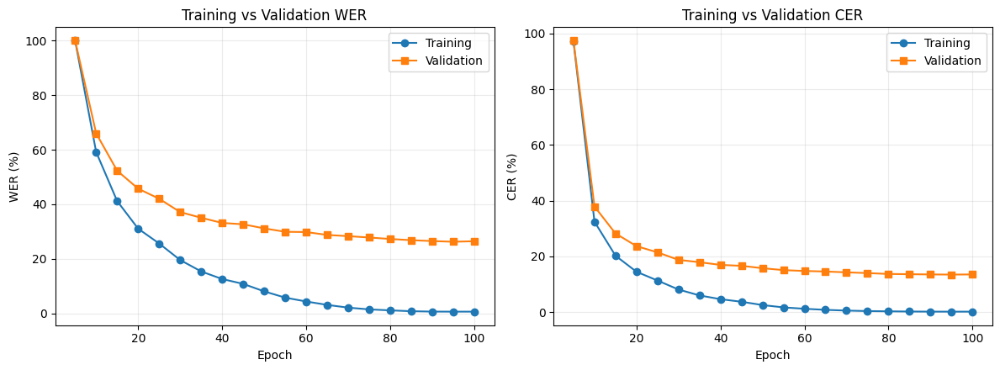
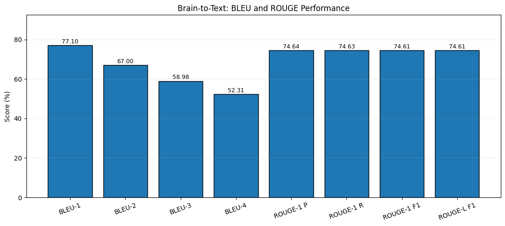
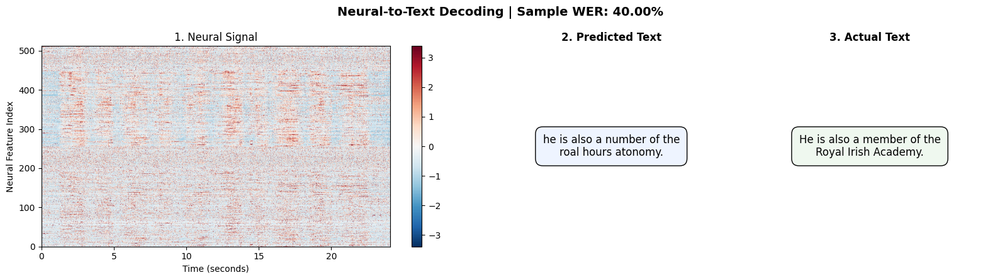

# Brain-to-Text Decoding with CNN–BiLSTM–CTC

**Direct character-level decoding from intracortical neural recordings | PyTorch | Brain-to-Text 2025**

This repository implements a **CNN–BiLSTM–CTC** neural-to-text decoder trained on the [Brain-to-Text 2025 Kaggle competition](https://www.kaggle.com/competitions/brain-to-text-25) data. The model converts pre-extracted neural activity features into text **without an external language model**. Neural preprocessing is *adapted from* the publicly released [Card et al. brain-to-text baseline](https://github.com/Neuroprosthetics-Lab/nejm-brain-to-text); the **network architecture and target representation are different**.

> **Scope:** This is an independently trained architectural alternative, **not** a faithful reproduction of the official phoneme-GRU baseline, and the reported figures are validation results—not hidden-test scores or evidence of superiority over that baseline.

## Key results

Results below are transcribed from the **uploaded, completed 100-epoch notebook run**. The best checkpoint was selected using **validation WER** at epoch **95**; the validation set contains **1,426** examples, and the training set contains **8,072** examples.

| Metric | Best validation result |
| :-- | --: |
| **Word Error Rate (WER)** ↓ | **26.26%** |
| **Character Error Rate (CER)** ↓ | **13.48%** |
| BLEU-1 ↑ | 77.10% |
| BLEU-4 ↑ | 52.31% |
| ROUGE-1 F1 ↑ | 74.61% |
| ROUGE-L F1 ↑ | 74.61% |
| Exact sentence match ↑ | 23.91% |

The model contains **17,563,174 parameters** with the vocabulary size used for the parameter check (`vocab_size=38`). The run measures all metrics on the **validation** split; inference also produced 1,450 unlabeled test predictions, which are **not** reported as test performance.



> **Interpretation:** A training WER of **0.61%** versus validation WER of **26.26%** at epoch 95 shows a substantial generalization gap. This warrants future evaluation rather than claims of strong out-of-distribution robustness.

## Method

```text
Pre-extracted neural features (512 channels, 20 ms per bin)
                     |
Gaussian temporal smoothing (σ = 2 bins, kernel = 100)
                     |
  Training only: white noise + feature offset + 0–2-bin cut
                     |
      Conv1D(512 → 256, kernel=11, stride=2)
                     |
      Conv1D(256 → 256, kernel=5, stride=2)
                     |
       3-layer bidirectional LSTM (512 hidden/direction)
                     |
           Linear → character logits
                     |
             Character-level CTC
                     |
         Greedy CTC collapse → decoded text
```

The implementation uses **batch normalization**, **ReLU**, and **dropout** after each convolution. The recurrent network is bidirectional and uses dropout between LSTM layers. The vocabulary is constructed from **training sentences only** and includes an explicit **CTC blank** token.

### Differences from the original baseline

| Aspect | Original phoneme-GRU baseline | This repository |
| :-- | :-- | :-- |
| Decoder | GRU-based recurrent network | CNN + 3-layer BiLSTM |
| Target sequence | Phonemes | Characters |
| Sequence criterion | Phoneme CTC | Character CTC |
| Post-processing | Phoneme-to-text decoding supported by a language model | Greedy character decoding; **no LM** |
| Feature preprocessing | Public baseline's neural preprocessing | Adapted smoothing/augmentation settings |
| Goal | Baseline speech-BCI transcription | Evaluate an alternative neural-to-character architecture |

**Not demonstrated:** that the CNN–BiLSTM architecture outperforms the official baseline. A valid comparison needs equivalent splits, scoring normalization, and controlled differences in the decoding pipeline. See [Baseline comparison](docs/BASELINE_COMPARISON.md).

## Repository structure

```text
brain-to-text-cnn-bilstm-ctc/
├── README.md
├── requirements.txt
├── .gitignore
├── notebooks/
│   └── brain_to_text_cnn_bilstm_ctc.ipynb   # Source-faithful, cleared-output notebook
├── src/
│   └── train.py                             # Same code, executable on Kaggle
├── results/
│   ├── best_validation_metrics.csv          # Values extracted from notebook logs
│   └── validation_history.csv               # Logged 5-epoch WER/CER measurements
├── figures/
│   ├── training_validation_WER_CER.png
│   ├── BLEU_ROUGE_metrics.png
│   └── Neural_to_Text_Decoding.png
└── docs/
    ├── BASELINE_COMPARISON.md
    └── REPRODUCIBILITY.md
```

## Reproduce on Kaggle

1. Accept the rules for the [Brain-to-Text 2025 competition](https://www.kaggle.com/competitions/brain-to-text-25) and attach its dataset to a Kaggle notebook.
2. Enable **GPU** in the Kaggle runtime, and use a PyTorch-compatible Python environment.
3. Open `notebooks/brain_to_text_cnn_bilstm_ctc.ipynb` and run cells in order. The notebook installs `jiwer` and `rouge-score` if missing. Alternatively, upload the repository contents to Kaggle and run the source script.
4. Verify the HDF5 root is available at the notebook's configured path:
   ```python
   CONFIG['data_dir'] = '/kaggle/input/competitions/brain-to-text-25/t15_copyTask_neuralData/hdf5_data_final'
   ```
   **If your mounted location differs, edit this line in Cell 1 / `src/train.py`.** The loader searches recursively for `data_train.hdf5`, `data_val.hdf5`, and `data_test.hdf5`.
5. Train for the notebook's configured **100 epochs** (`batch_size=64`, `learning_rate=1e-3`, AdamW + OneCycleLR, seed 42). WER/CER and broader text metrics are recorded every **5 epochs**.
6. Inspect the best saved model at `/kaggle/working/best_model.pt` and evaluation files under `/kaggle/working/brain_to_text_results/`.

**For running the extracted script in a Kaggle terminal:**

```bash
python src/train.py
```

The script uses the **same fixed Kaggle paths** as the notebook. An outside-Kaggle runtime needs appropriate path edits, dependencies and access to data. Full training **has not been re-executed** as part of repository packaging. See [Reproducibility notes](docs/REPRODUCIBILITY.md).

## Evaluation and example

The notebook computes WER and CER using `jiwer`, BLEU with NLTK, ROUGE with `rouge-score`, and case-insensitive exact sentence-match accuracy. Checkpoint selection is based only on validation WER.





**Metric comparability warning:** This implementation lowercases references and predictions for WER/CER, but does **not** explicitly apply the official competition's full text normalization/punctuation scoring pipeline. Do not compare its 26.26% WER numerically with published or leaderboard scores until evaluation protocols are matched.

## Current limitations

- **No head-to-head reproduced baseline** under matched training and scoring settings.
- **No controlled ablation** isolating effects of convolution, BiLSTM, or each augmentation.
- **Validation-based model selection** means these are validation scores, not an independent final evaluation.
- **Greedy decoding** only; no beam search or external language model.
- **Potential train/validation overfitting**, reflected in the WER gap.
- **Test `submission.csv` uses sequential IDs constructed by the notebook.** Confirm the required ID mapping and row order against the competition's official submission specifications before uploading it.
- **Data and model weights are not included**, including potentially restricted neural recordings and ~17.6M-parameter checkpoints.

## Planned experiments

1. Controlled phoneme-GRU vs character CNN–BiLSTM comparison under carefully documented protocol differences.
2. Remove/consolidate Gaussian smoothing, white noise, constant offset, and temporal cut to quantify individual gains.
3. Character-GRU, character-BiLSTM, and CNN–BiLSTM architectural ablations.
4. Normalized WER/CER evaluation and error-type analysis; ideally separate held-out evaluation data.

These are **future directions**, not experiments already completed in this repository.

## References and acknowledgment

- Card et al., *An Accurate and Rapidly Calibrating Speech Neuroprosthesis*, 2024. Official public implementation: https://github.com/Neuroprosthetics-Lab/nejm-brain-to-text
- [Brain-to-Text 2025 Kaggle competition](https://www.kaggle.com/competitions/brain-to-text-25)

This repository uses competition-provided pre-extracted neural features and **adapts preprocessing hyperparameters** from the public implementation. It is not endorsed by the dataset authors or the competition organizers.

